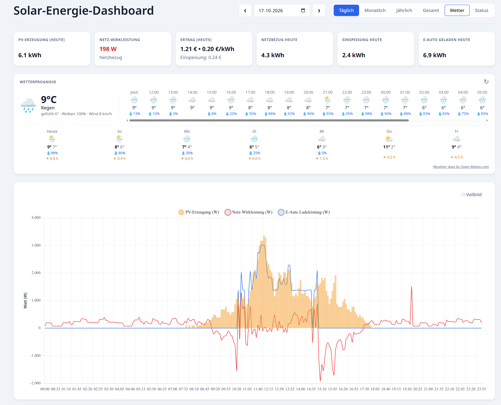

# Webapp

The `webapp/` directory contains a static dashboard for viewing P1 grid data
and SMA PV data, with an optional weather forecast panel. It must be served by
a web server. Opening `index.html` directly from the file system will not work
reliably because the dashboard loads its data with HTTP requests.

## Dashboard preview



The image is documentation only and is not needed for the dashboard to run.

## Capabilities

- **Four views:** daily (5-minute power curves), monthly (daily totals),
  yearly (monthly totals) and total, with date, month and year navigation.
- **KPI cards:** PV generation, grid active power, grid import, grid export,
  EV charger energy and, for permitted users, financial yield. Monthly and
  yearly views show forecasts based on typical production profiles.
- **Interactive chart** with a fullscreen mode.
- **Weather forecast panel** (optional, can be switched on and off) with
  current conditions, an hourly forecast for the next 24 hours and a 7-day
  forecast including expected sunshine hours. See
  [Weather forecast](#weather-forecast).
- **Status dialog** with the local time, system uptime, the age of the latest
  PV and smart meter data, lifetime counters and the light/dark theme switch.
- **German and English** user interface, selected automatically from the
  browser language preferences.
- **Responsive layout** for desktop, tablet and phone, plus an installable
  PWA (web app manifest and icons).
- **Login protection** of the dashboard and its data folders through Apache
  form authentication with an encrypted session cookie, an optional HTTP Basic
  access for an external app on the PV data, and financial yield values
  restricted to selected users. See
  [Required web server settings](#required-web-server-settings).

## Directory layout

The web server document root contains three folders: `webapp/` with the
dashboard itself and the two data folders `p1/` and `pv/`. The dashboard
requests its data with absolute paths (`/p1/...` and `/pv/...`), so the data
folders must sit next to `webapp/`, directly below the document root. Each of
the three folders has its own `.htaccess` file.

```text
web-root/
|-- webapp/
|   |-- .htaccess             (form login, session, yield permission)
|   |-- index.html
|   |-- login.html            (public)
|   |-- app.js
|   |-- p1.js
|   |-- pv.js
|   |-- weather.js
|   |-- weather-config.json   (optional, your weather location)
|   |-- i18n.js
|   |-- styles.css
|   |-- manifest.json
|   |-- sw.js
|   |-- ... icons and other webapp files ...
|-- p1/
|   |-- .htaccess             (form login protection)
|   |-- p1_data-20260819.csv
|   |-- p1_data-202608.csv
|   |-- energy-prices.csv     (optional)
|-- pv/
    |-- .htaccess             (form login + HTTP Basic for an external app)
    |-- pv_data-20260819.csv
    |-- pv_data-202608.csv
```

The login page, the login form target and the redirect after login use the
paths `/webapp/login.html`, `/webapp/dologin` and `/webapp/index.html`. If
you serve the dashboard from a different folder, change these paths in
`webapp/.htaccess` and `login.html`.

For a quick local test without any protection, copy or link the data
directories into `webapp/` and serve that directory:

```bash
cd webapp
python3 -m http.server 8000
```

Open `http://localhost:8000/` in a browser. A simple server such as this
does not provide the authentication or permission behavior described below
and should only be used for local, non-sensitive testing. In any real setup
the server must allow the files in `/p1/` and `/pv/` to be read, should
return the CSV files as plain text, and should use HTTPS.

## Required web server settings

The dashboard is designed for Apache HTTP Server 2.4 and is protected by form
login. This section describes the complete configuration. Setting it up in
this order avoids most problems: modules, `.htaccess` permissions, password
files, session encryption, then the three `.htaccess` files.

### Who can access what

| Folder | Who | How |
| --- | --- | --- |
| `/webapp/` | Dashboard users | Form login. `login.html` and the icons are public so the login form can be reached. |
| `/p1/` | Dashboard users | The same form login session. Without a valid session the server answers `401`. |
| `/pv/` | Dashboard users, and optionally an external app | Dashboard users use the same session. An external app uses HTTP Basic authentication over HTTPS with its own account. |

All three folders share one session cookie (`solar_auth`, valid for the whole
site), so logging in to the dashboard also authorizes the browser's data
requests to `/p1/` and `/pv/`. Opening a CSV link in a logged-in browser works
as well.

### Apache modules

Enable these modules:

| Module | Used for |
| --- | --- |
| `mod_auth_form`, `mod_authn_file`, `mod_authz_core` | Form login against a password file |
| `mod_session`, `mod_session_cookie` | Keeping the login in a session cookie |
| `mod_session_crypto` | Encrypting the session cookie (required for the `SessionCryptoPassphrase` line) |
| `mod_auth_basic` | HTTP Basic login for an external app (only needed for `pv/`) |
| `mod_rewrite` | The virtual `/webapp/dologin` login endpoint |
| `mod_headers` | Restricting financial yield values and the icon headers |

On Debian and Ubuntu:

```bash
sudo a2enmod auth_form authn_file authz_core session session_cookie \
    session_crypto auth_basic rewrite headers request
sudo apachectl configtest
sudo systemctl restart apache2
```

`request` is commonly enabled together with `auth_form`. On Red Hat, CentOS
and Fedora based systems, install the `mod_session` package and the crypto
driver package `apr-util-openssl`, and make sure the modules are loaded in the
Apache configuration. Always run `apachectl configtest` (or `httpd -t`)
before restarting. If a module is missing, the web server answers requests
for that folder with a `500` error and the error log names the unknown
directive, for example `Invalid command 'SessionCryptoPassphrase'`.

### Allowing .htaccess files

Apache only reads the directives in the `.htaccess` files if the virtual host
allows it. In the virtual host (or server) configuration, the document root
needs at least:

```apache
<Directory /var/www/example/>
    AllowOverride AuthConfig FileInfo Options
</Directory>
```

`AuthConfig` covers login, session and `Require` directives, `FileInfo`
covers `RewriteRule`, `SetHandler` and `Header`, and `Options` covers
`Options -Indexes`. `AllowOverride All` also works. If an `.htaccess` file
uses a directive that is not allowed, the error log reports
`not allowed here`.

### Password files

Keep the password files outside the document root so they cannot be
downloaded. The dashboard accounts and the external app account are stored in
two separate files, so the app account cannot log in to the dashboard:

```bash
sudo mkdir -p /usr/local/websecure

# Dashboard users (form login)
sudo htpasswd -B -c /usr/local/websecure/.htpasswd admin
sudo htpasswd -B /usr/local/websecure/.htpasswd dashboard-user

# External app that reads /pv/ over HTTP Basic (optional)
sudo htpasswd -B -c /usr/local/websecure/.htpasswd-pvapp pvapp

sudo chgrp www-data /usr/local/websecure/.htpasswd*
sudo chmod 640 /usr/local/websecure/.htpasswd*
```

Use the group that your Apache runs as (`www-data` on Debian and Ubuntu,
`apache` on Red Hat based systems). Every account in `.htpasswd-pvapp` can
read the `pv/` folder from outside the dashboard, so give it a dedicated
password and add only accounts that need it.

### Session cookie and encryption

With form login, the session cookie contains the login details. Two settings
protect it:

- **Cookie settings.** The cookie is named `solar_auth` and is valid for the
  whole site (`path=/`). The previous setting `path=/webapp/` must not be used
  any more, because the browser would then not send the cookie to `/p1/` and
  `/pv/`. The flags `httponly` (not readable by scripts) and `secure` (only
  sent over HTTPS) are recommended. Remove `secure` only if you use the
  dashboard over plain HTTP, otherwise the login silently fails.
- **Encryption.** Add a long random value as `SessionCryptoPassphrase`. This
  encrypts the cookie content. Create a value with
  `openssl rand -base64 48`.

The older instruction `SessionCookieName ... Secret=...` has no effect:
`Secret=` is not an Apache option and was only sent to the browser as a
meaningless cookie attribute. Remove it. The passphrase is the real
protection.

Where to set the passphrase:

- **In the virtual host configuration (recommended).** It then applies to the
  whole site and exists in one place only. The `.htaccess` files do not need
  the line.
- **In each `.htaccess` file.** Allowed as well, but the value must be
  identical in `webapp/`, `p1/` and `pv/`, otherwise a session created in one
  folder cannot be read in another. A passphrase file outside the document
  root (`SessionCryptoPassphraseFile`) is possible in the virtual host
  configuration only.

The session lines (cookie name, flags, `SessionMaxAge` and the passphrase if
set per file) must be identical in all three `.htaccess` files. Changing the
cookie name or the passphrase logs out all users once.

### webapp/.htaccess

```apache
# ----------------------------------------------------------------------
# Rewrite & Session Setup
# ----------------------------------------------------------------------
RewriteEngine On

Session On
SessionCookieName solar_auth path=/;httponly;secure
SessionMaxAge 604800
# Omit this line if SessionCryptoPassphrase is set in the virtual host.
SessionCryptoPassphrase replace-with-a-long-random-value

# ----------------------------------------------------------------------
# Form Authentication Setup
# ----------------------------------------------------------------------
AuthType Form
AuthName "Protected area"
AuthFormProvider file
AuthUserFile /usr/local/websecure/.htpasswd

AuthFormLoginRequiredLocation "/webapp/login.html"
AuthFormLoginSuccessLocation "/webapp/index.html"

Require valid-user

# Only these authenticated users may see financial yield values.
# Extend the regular expression with the usernames that should have access.
<IfModule mod_headers.c>
    Header set X-Yield-Access "true" "expr=%{REMOTE_USER} =~ m#^(admin|energy-manager)$#"
</IfModule>

# ----------------------------------------------------------------------
# Virtual Login Endpoint & Unprotected Resources
# ----------------------------------------------------------------------
# Handle POST request to /webapp/dologin virtually
<Files "dologin">
    SetHandler form-login-handler
    AuthFormLoginRequiredLocation "/webapp/login.html?error=1"
</Files>

# Route virtual /webapp/dologin requests to the handler file
RewriteCond %{REQUEST_URI} ^/webapp/dologin$
RewriteRule ^dologin$ - [H=form-login-handler]

# Allow public access to the login page
<Files "login.html">
    Require all granted
</Files>

# Allow public access to icons
<FilesMatch "^(apple-touch-icon|favicon).*\.(png|ico|svg)$">
    Require all granted
    <IfModule mod_headers.c>
        Header set Access-Control-Allow-Origin "*"
    </IfModule>
</FilesMatch>
```

All authenticated users can view the dashboard. Financial yield values are
shown only to usernames matching the regular expression in the
`X-Yield-Access` rule. Replace the usernames inside the expression with the
accounts that should see yield values. Users not matching the expression can
still use the dashboard, but the yield card remains hidden. Keep the
`X-Yield-Access` response header rule unchanged because the dashboard reads
it from `index.html` to apply this permission. The rule is needed only in
`webapp/`.

### p1/.htaccess

```apache
Options -Indexes

Session On
SessionCookieName solar_auth path=/;httponly;secure
SessionMaxAge 604800
# Omit this line if SessionCryptoPassphrase is set in the virtual host.
SessionCryptoPassphrase replace-with-a-long-random-value

AuthType Form
AuthName "Protected area"
AuthFormProvider file
AuthUserFile /usr/local/websecure/.htpasswd

Require valid-user
```

The file contains no login redirect on purpose. A request without a valid
session gets a plain `401` instead of the login form, which is what scripts
and direct links should receive. The rewrite rules, the `dologin` handler, the
public exceptions and the yield header are not needed here.

### pv/.htaccess

```apache
Options -Indexes

AuthName "Protected area"

Session On
SessionCookieName solar_auth path=/;httponly;secure
SessionMaxAge 604800
# Omit this line if SessionCryptoPassphrase is set in the virtual host.
SessionCryptoPassphrase replace-with-a-long-random-value

<If "-n %{HTTP:Authorization}">
    # External app: HTTP Basic, HTTPS only, separate account
    AuthType Basic
    AuthBasicProvider file
    AuthUserFile /usr/local/websecure/.htpasswd-pvapp
    <RequireAll>
        Require valid-user
        Require expr "%{HTTPS} == 'on'"
    </RequireAll>
</If>
<Else>
    # Dashboard in the browser: form login session
    AuthType Form
    AuthFormProvider file
    AuthUserFile /usr/local/websecure/.htpasswd
    Require valid-user
</Else>
```

Apache allows one authentication type per request, so this file chooses it
per request: a request that carries an `Authorization` header is treated as
HTTP Basic and checked against `.htpasswd-pvapp` (HTTPS only), every other
request uses the form login session. Accounts of the two password files are
not interchangeable.

- If no external app needs access to `pv/`, use the same file as for `p1/`
  instead (form login only, no `<If>` branch and no `.htpasswd-pvapp`).
- If TLS is terminated by a proxy in front of Apache, `%{HTTPS}` is never
  `on`. Remove the `Require expr` line in that case and enforce HTTPS at the
  proxy.
- Some clients only send Basic credentials after the server challenges them.
  If the app always gets `401`, add the following line. It makes a direct
  link in a logged-out browser show a password dialog, which only accepts the
  app account:

  ```apache
  Header always set WWW-Authenticate "Basic realm=\"Protected area\"" "expr=%{REQUEST_STATUS} == 401"
  ```

### Testing the setup

1. Run `apachectl configtest`, then reload Apache.
2. Log in to the dashboard in a browser. The daily, monthly and yearly views
   must show data.
3. In a private browser window, open `https://yourhost/p1/p1_data-YYYYMMDD.csv`
   and `https://yourhost/pv/pv_data-YYYYMMDD.csv`. Both must answer with an
   error (`401`), not with the data.
4. Test the external app account:
   `curl -u pvapp:PASSWORD https://yourhost/pv/pv_data-YYYYMMDD.csv` must
   return the file, the same request against `/p1/...` must return `401`,
   and the same request over plain `http://` must be refused.
5. In the browser's developer tools, open the `solar_auth` cookie. Its value
   must look like random text and must not contain your username.

### Troubleshooting

| Symptom | Likely cause |
| --- | --- |
| `500` error and `Invalid command '...'` in the error log | The module for that directive is not enabled. Enable it (see Apache modules) and restart. |
| `500` error and `not allowed here` in the error log | The virtual host does not allow the directive. Extend `AllowOverride`. |
| Dashboard loads, but charts stay empty | The browser does not send the session cookie to `/p1/` and `/pv/` (cookie path not `/`, different cookie names) or the passphrase differs between the folders. |
| Login form reappears after every login | The cookie flag `secure` is set but the dashboard is used over HTTP, or the passphrase changed. |
| External app always gets `401` | Wrong account (it must be in `.htpasswd-pvapp`), request over HTTP, TLS terminated at a proxy (see above), or the client does not send credentials before a challenge. |
| Everyone is logged out | Expected after changing the cookie name or the passphrase. |

The Apache error log is usually `/var/log/apache2/error.log` on Debian and
Ubuntu and `/var/log/httpd/error_log` on Red Hat based systems.

### Security notes

- Use HTTPS for everything. Cookies and Basic credentials are only protected
  in transit by TLS.
- Keep the passphrase long and random, and treat it like a password. Do not
  commit it to a public repository.
- Financial yield values are hidden in the user interface only. All
  logged-in users can technically read the underlying files, including
  `p1/energy-prices.csv`. If prices must be restricted, add a `<Files>` block
  with a `Require expr` rule for `energy-prices.csv` in `p1/.htaccess`.
- Directory listings are disabled by `Options -Indexes`.

## Weather forecast

The weather panel is an optional feature of the dashboard. It is hidden by
default and is switched on and off with the **Weather** (German: **Wetter**)
button in the header menu. The last choice is remembered per browser.

### What it shows

- **Current conditions:** temperature, feels-like temperature, weather
  description, cloud cover and wind speed.
- **Next 24 hours:** a horizontally scrollable strip with temperature, weather
  symbol and rain probability for each hour.
- **Next 7 days:** daily high and low, weather symbol, rain probability and
  expected hours of sunshine, which is useful for judging PV production.

The panel refreshes automatically every 30 minutes while it is visible and
can be refreshed manually with the refresh symbol in the panel header. The
last response is cached in the browser and shown again if a later request
fails. Nothing is requested while the panel is hidden.

### Data source and requirements

Weather data comes from [Open-Meteo](https://open-meteo.com/), which is free
and needs no account or API key. A Google weather widget is not used because
Google does not provide an embeddable weather widget.

- The **browser** (not the web server) requests the data directly from
  `https://api.open-meteo.com`. The device viewing the dashboard therefore
  needs internet access, even if the dashboard itself runs in a local network.
- The configured coordinates are sent to Open-Meteo with each request. Use
  approximate coordinates (for example the nearest town) if you do not want to
  reveal the exact location of the installation.
- If the web server sends a `Content-Security-Policy` header, `connect-src`
  must allow `https://api.open-meteo.com`. Otherwise the browser blocks the
  request and the panel shows "Weather data currently unavailable". The
  browser console names the blocked request.
- The "Weather data by Open-Meteo.com" link in the panel provides the
  attribution that Open-Meteo requires. Keep it in place.

### Configuring the location

The forecast is calculated for a fixed position given as decimal degrees of
latitude and longitude (north and east are positive, south and west are
negative). The location is taken from the first of these sources that
provides valid coordinates:

1. a per-browser override (for testing),
2. the optional file `weather-config.json`,
3. the built-in defaults in `weather.js`.

**Recommended: `weather-config.json`.** Create this file in the same folder
as `index.html`:

```json
{
  "lat": 48.12,
  "lon": 14.73
}
```

Because the location lives in its own file, updating `weather.js` (or any
other webapp file) never resets it. Do not include `weather-config.json` when
copying updated webapp files to the server, or it will be overwritten. The
file is read each time the dashboard is loaded, so a change takes effect on
the next page reload. Coordinates for a town or address can be read from any
map service, for example by right-clicking the location in OpenStreetMap or
Google Maps.

The file is optional. If it is missing, not valid JSON, or contains
coordinates outside the valid range (latitude -90 to 90, longitude -180 to
180), it is ignored and the defaults are used. It is served and protected
like the other webapp files, so only logged-in users can read it.

**Built-in defaults.** Without a config file, the constants at the top of
`weather.js` apply:

```javascript
const WEATHER_DEFAULT_LAT = 48.12;
const WEATHER_DEFAULT_LON = 14.73;
```

**Override for a single browser or device.** Open the browser developer
console on the dashboard page and run:

```javascript
localStorage.setItem('weather_lat', '48.12');
localStorage.setItem('weather_lon', '14.73');
```

Reload the page. The override is stored only in that browser and takes
precedence over both the config file and the defaults. Remove it to return
to them:

```javascript
localStorage.removeItem('weather_lat');
localStorage.removeItem('weather_lon');
```

The cached forecast is tied to the coordinates, so changing the location
always loads a fresh forecast.

### Other weather settings

These constants at the top of `weather.js` can be changed if needed:

| Constant | Default | Meaning |
| --- | --- | --- |
| `WEATHER_REFRESH_MS` | 30 minutes | How often the forecast is refreshed while visible and how long the cache is considered fresh |
| `WEATHER_HOURS_SHOWN` | 24 | Length of the hourly strip |

The forecast uses the same time zone as the rest of the dashboard. Weather
descriptions and labels are translated through `i18n.js` (keys beginning with
`weather` and `wx`).

## Required filenames

The dashboard uses these filenames. `YYYYMMDD` is the date and `YYYYMM` is
the month, both without separators.

| Data | Daily file | Monthly file |
| --- | --- | --- |
| P1 | `p1/p1_data-YYYYMMDD.csv` | `p1/p1_data-YYYYMM.csv` |
| PV | `pv/pv_data-YYYYMMDD.csv` | `pv/pv_data-YYYYMM.csv` |

An optional typical monthly PV distribution can be provided:

| Distribution | File |
| --- | --- |
| Yearly profile by month | `pv/yearly-distribution.csv` |

The daily profile is always calculated dynamically in the browser from the
average of the last seven completed PV days. This accounts for the actual
sunrise and sunset times from recent days. The monthly profile is read from
the file or, if the file is missing, calculated from available monthly PV
files from up to five previous years.

The P1 controller creates files with these names when its base path is
`p1_data.csv` (the default). The JavaScript also accepts the older
`p1-data-...` spelling and several SMA export names for compatibility; use
the names above for a new setup.

Energy prices for the yield calculation are read from `p1/energy-prices.csv`
(date, import price, export price per row; lines starting with `#` are
ignored). The price valid on a given day is the latest entry on or before
that day.

## File formats

### P1 CSV files

P1 files are comma-separated CSV files. The daily file contains cumulative
meter readings and instantaneous power:

```text
timestamp,import_kwh,export_kwh,active_power_w
2026-08-19 12:00:00,1234.567,456.789,850
```

`import_kwh` and `export_kwh` are cumulative meter values. `active_power_w`
is the current grid power in watts; positive means importing and negative
means exporting. The monthly file contains one daily total per row:

```text
date,import_kwh,export_kwh
2026-08-19,12.345,4.567
```

If an EV charger is connected, the daily file can carry two further columns,
`charger_total_kwh` (cumulative) and `charger_power_w`, and the monthly file
a fourth column `charger_kwh` (daily total). They feed the EV charging card
and chart series; without them these values show as zero.

### PV CSV files

PV files use the semicolon-separated SMA export format. The dashboard reads
the timestamp from column 1 and the value from column 3. Decimal commas are
accepted and PV values are interpreted as kW.

```text
sep=;
dd.MM.yyyy HH:mm:ss;Time;Power
19.08.2026 12:00:00;12:00:00;4,250
```

Daily PV files are normally recorded at five-minute intervals. Monthly PV
files contain daily totals, using the same date and value columns. SMA
metadata and header lines are ignored.

`pv.js` shifts PV timestamps by `PV_TIME_OFFSET_MINUTES` (currently -10) so
that the PV curve lines up with the P1 curve. Adjust this constant if the two
curves are offset against each other.

## Adjusting filenames

If your files use different names or directories, update the path lists in
`p1.js` and `pv.js` to match the files exposed by the web server. Because the
paths start with `/p1/` and `/pv/`, they are resolved relative to the web
server document root.
